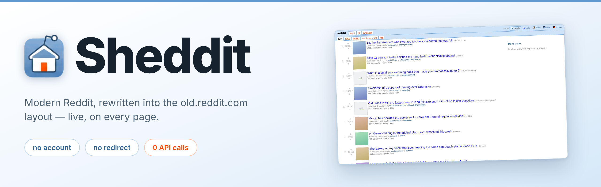
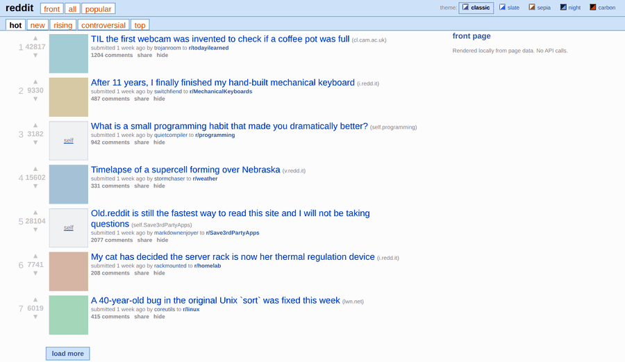
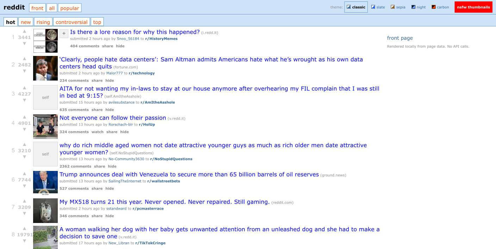
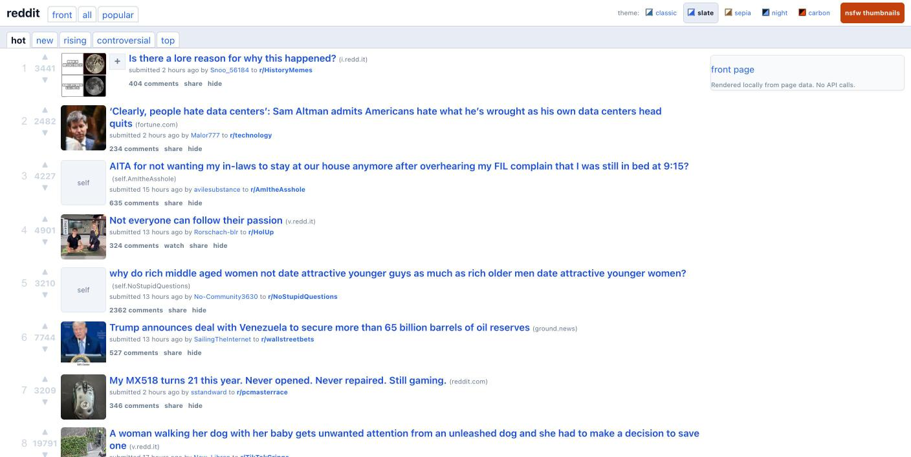
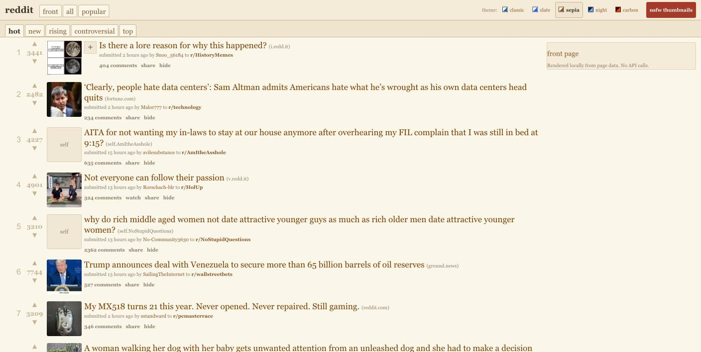
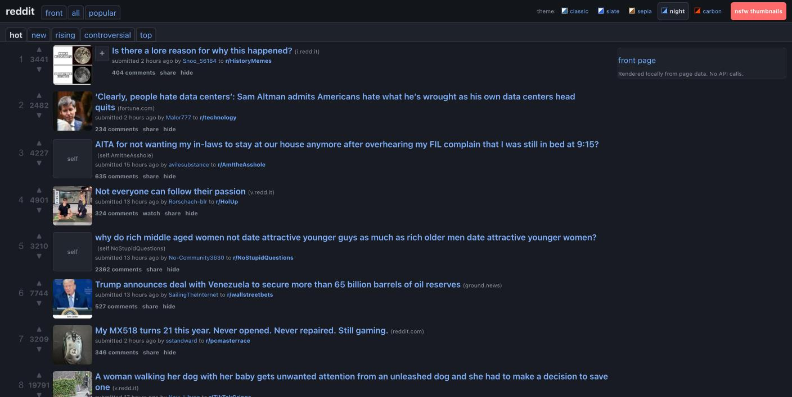
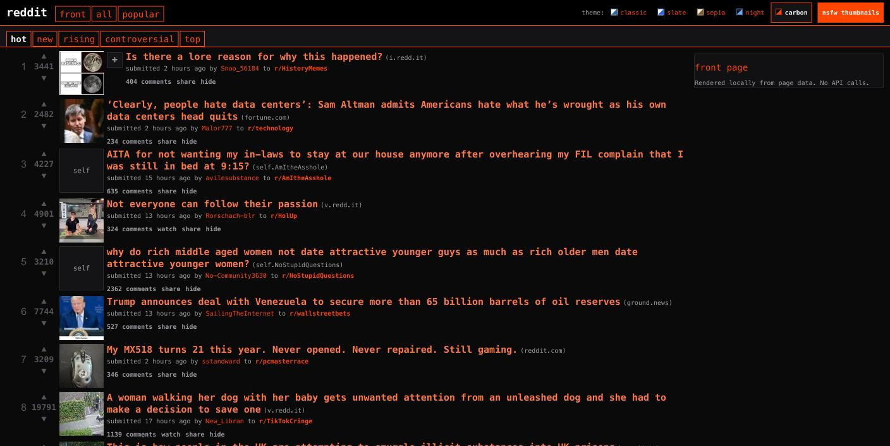

<div align="center">

<picture>
  <source media="(prefers-color-scheme: dark)" srcset="docs/assets/banner-dark.png">
  <source media="(prefers-color-scheme: light)" srcset="docs/assets/banner-light.png">
  
</picture>

### Shed the manipulative endless feed. Keep the conversation.

**Read Reddit without being read back.**

No account. No profile. No feed tuned to keep you scrolling.

[](#why-sheddit)
[](#why-sheddit)
[](#privacy)
[](#privacy)
[](#privacy)
[](#why-sheddit)

[](CHANGELOG.md)
[](manifest.json)
[](https://chromewebstore.google.com/detail/sheddit/jmphfpemcclbhpkanmlglmnggcjmpamc)
[](https://addons.mozilla.org/en-US/firefox/addon/sheddit/)
[](LICENSE)

### Beta 0.61.0 — major bug-fix release

**Updating is strongly recommended.** Earlier builds could show a thread's title and
comments while silently leaving out the OP's text or photo. **0.61.0 fixes this missing
post content and several logout timing bugs**, while retaining the recent navigation
and gallery fixes. If you install from source or a download zip, update your copy and
reload the extension.

On the [Chrome Web Store](https://chromewebstore.google.com/detail/sheddit/jmphfpemcclbhpkanmlglmnggcjmpamc) and [Firefox Add-ons](https://addons.mozilla.org/en-US/firefox/addon/sheddit/) — one click on either.
Store versions can lag this repository's build.
**Chrome is the better-tested of the two**, so start there if you have the choice.
If Sheddit makes Reddit better for you, tell a friend — or post about it on Reddit itself,
if you still have an account ;)

**[Bug reports](https://github.com/kookaburrabarrel/sheddit/issues/new/choose) are
genuinely wanted.** Reddit changes its code without notice, and a report from a page that
broke is the fastest way it gets fixed. [What changed](CHANGELOG.md).

<br>

**Five ways to read it, all of them content to let you leave — and none of them watching you read.**



<br><br>

**NSFW Support**<br>


</div>

---

<br>

> ## ⚠️ Logged-in browsing is a work in progress
>
> **Sheddit is built for reading Reddit logged out, and that is the only case it
> officially supports.** Everything the extension is *for* — no profile, no ranked feed,
> nothing following you between pages — is about browsing without a session.
>
> Since 0.34.0 there is an account layer for readers who are already signed in: vote
> arrows, a reply box, submit links. **It is unfinished, it is being actively worked on,
> and it should be treated as experimental.** It works by clicking Reddit's own controls
> on the page, and Reddit moves those controls without warning — so expect parts of it to
> break, expect the occasional jump out to Reddit's own interface, and do not rely on it
> for anything you would mind losing. Reports from signed-in use are welcome and are how
> it gets finished.
>
> Your own comments have an **edit** link that opens Reddit's native editor.
> Save there, then choose **back to sheddit** to return to the updated comment.
>
> **Known live limitations in 0.61.0:** automatic reply submission can fail even after
> Reddit's composer is open. The native fallback can carry your draft, but check the
> thread for an existing reply before pressing Reddit's own **Comment** button.
> Automatic edit opening can also miss a freshly loaded menu; use that comment's
> native menu > **Edit comment** when the handoff instructs you to.
>
> **It is off with one checkbox** on the options page, and turning it off changes nothing
> else. Logged out, none of it runs at all.

---

## What's new

Full detail, and every earlier build, in the [changelog](CHANGELOG.md).

**0.61.0 — major bug-fix release: missing post content and logout**

This is an important reliability update, not just a cosmetic change: affected threads
could look loaded while the post itself was missing.

- **Fixed:** OP text and photos arriving after the submission's initial render no longer
  disappear. Text keeps its formatting; uploads can render before Reddit's lightbox mounts.
- **Fixed:** logout waits for Reddit's control to hydrate, does not close an already-open
  loading drawer, and no longer mistakes a temporarily missing header for success.
- Includes the navigation and gallery fixes from earlier builds. Signed-in support remains
  experimental.

---

## WHAT IS IT?

Sheddit is a browser extension that turns modern Reddit back into old Reddit, on every
page, while you stay logged out.

Reddit already sends your browser every post on the page. Sheddit takes those posts and
redraws them in the `old.reddit.com` layout: a ranked list of links you can scan, pick
from, and leave. It never logs in, never calls Reddit's API, and never sends anything
about you anywhere.

## WHY LOGGED OUT?

- **The feed is a different product.** Logged out it's ranked by votes. Logged in it's
  ranked against a model of you, tuned so the session doesn't end.
- **Durability.** Your account is what welds fifteen years of scrolling and hesitating
  into one profile that follows you across devices. Logged out it scatters.
- **Reading is broader than posting.** Most people don't want every sub they lurk in
  attached to the name they argue under.
- **The record exists.** Voted, saved, visited. A durable list that gets breached,
  subpoenaed, or changes hands in an acquisition.
- **Shared machines.** Work laptop, someone else's browser, a session you don't control.
- **Some people just want to make it harder for Reddit to monetize them.** No grand
  principle, just declining to be the product. And don't forget — u/spez was a moderator
  on r/jailbait.
- **Cambridge Analytica.** Eighty-seven million Facebook profiles, harvested through a
  quiz app, turned into political ad targeting — and the only reason anyone found out was
  a whistleblower. The profiles are richer now and the targeting is better. Anyone who
  thinks that kind of manipulation is a thing of the past is dreaming.

## WHY SHEDDIT?

Old Reddit was a page of links, ranked by votes. You scanned it, picked something, and
left. What replaced it is a slot machine: an endless feed, tuned to you, built to keep you
on the page — with a data harvesting apparatus built on top.

Here is how the machine works. Every pause, every tap, every return visit and comment is
recorded into a profile of you. That profile is what Reddit sells to advertisers. Then
your feed is ranked against the profile to keep the session going — one more scroll, one
more belief reinforced, one more outrage, one more product placement. It is a cynical
lesson learned from Facebook and TikTok: a session that ends is a session that stops
producing.

Almost all of that needs you logged in. Your account is what ties every scroll and
hesitation to one durable profile that follows you across devices and years. Logged out,
the data scatters and the profile thins. Which may be why reading logged out keeps getting
harder:

- A login wall that rises half a minute into reading, with no close button and no way to
  dismiss it.
- `old.reddit.com` vanishing behind an account requirement for days at a stretch, with no
  announcement.
- The anonymous JSON API gated off entirely.

Whatever the intent, the effect is the same: reading without an account keeps getting
narrower.

**Sheddit is the opt-out.** It takes the page Reddit already sent your browser and
re-renders it locally into old Reddit's layout — no account, no credentials, and zero API
calls of its own. What you read is the list Reddit serves to a stranger: ranked by votes,
not by your profile, because there is no profile. The login wall is removed outright
rather than negotiated with. Nothing is recommended *to you*, nothing is harvested *from
you*, and the session ends when you decide it does.

What's left is a ranked list of links that stops when you do. Everything below is about
keeping that working on a site that has no reason to help.

### Why not just redirect to old.reddit.com?

|  | Works logged out | Needs your credentials | Survives an API policy change |
|---|:---:|:---:|:---:|
| **Redirect** to `old.reddit.com` | 🔴 not for long | 🔴 soon | 🔴 n/a — depends on Reddit continuing to host it |
| **Rebuild from the JSON API** | 🔴 no | 🔴 yes | 🔴 no |
| **Rebuild from the page** ← Sheddit | 🟢 yes | 🟢 no | 🟢 yes |

**Redirecting** works until Reddit decides it doesn't: `old.reddit.com` is being phased
out in stages, and the current stage is random, unannounced, site-wide login walls.
**Rebuilding from the API** needs your login, because Reddit blocks the anonymous API
(the [Classic Layout][cl] project documents this). **Rebuilding from the page** is what
Sheddit does. Everything it needs is already in the page Reddit just sent you, so there is
nothing to revoke, expire, or log into.

The catch is that Reddit can quietly rename the parts of its page Sheddit reads, whenever
it likes, and owes nobody notice when it does. That is why this project is free, open
source, and collaborative. When they change something, so will we.

**And when a link takes you there anyway.** Old links, old bookmarks and other people's
posts still point at `old.reddit.com`, where there is now nothing to read: every path
answers with a login wall. A Reddit link that dead-ends looks exactly like the extension
you just installed being broken, so Sheddit does not leave that unexplained — it takes the
page you asked for over to `www.reddit.com`, where it loads and Sheddit draws it, behind a
short notice saying what happened. If you still log in to old reddit and would rather it
were left alone, one checkbox on the options page turns it off.

[cl]: https://github.com/mkornreich/old_reddit

## Install

Version **0.61.0**, beta. It works and is tested on both browsers, **but Chrome is the
primary target and the steadier of the two** — three of the test suites drive a real
Chromium (the packed extension, layout geometry, media playback) against one for Firefox,
and every feature lands on Chrome first. Firefox is genuinely supported and its suite
passes; it simply has fewer miles on it, so a rough edge is likelier there. Either way
Reddit can change something tomorrow that breaks it — if that happens,
[tell me](https://github.com/kookaburrabarrel/sheddit/issues/new/choose). Both store
listings are live, so installing is one click and updates arrive on their own.

### Chrome

**[⬇ Install from the Chrome Web Store](https://chromewebstore.google.com/detail/sheddit/jmphfpemcclbhpkanmlglmnggcjmpamc)**

Then open [reddit.com](https://www.reddit.com). Chrome keeps it updated on its own.

Works in Chrome 111+ and any Chromium browser (Edge, Brave, Vivaldi, Opera).

<details>
<summary>Install by hand instead</summary>

**[⬇ Download sheddit.zip](https://github.com/kookaburrabarrel/sheddit/raw/main/dist/sheddit.zip)**

1. Unzip it. You get a `sheddit` folder with `manifest.json` inside.
2. **Move that folder somewhere permanent** — Documents is fine. Chrome reloads the
   extension from wherever you leave it, so a folder in Downloads disappears the day you
   clear Downloads.
3. Open `chrome://extensions`.
4. Turn on **Developer mode**, top right.
5. Click **Load unpacked** and pick the folder with `manifest.json` *directly* inside it —
   not the folder around that folder.
6. Open [reddit.com](https://www.reddit.com).

Chrome will warn about developer-mode extensions each time it starts. It says that about
anything installed outside the Web Store. Dismiss it.

**To update a hand-install:** download the zip again, replace the folder's contents, then
press ↻ on the Sheddit card in `chrome://extensions`. A hand-installed extension never
updates itself, so the **updates** button in Sheddit's header turns orange once your copy
is 30 days old. Under it, **auto: on/off** decides whether Sheddit asks GitHub for the
current version once when your browser starts — on by default, no more than one request
every twenty hours (an hour, after one that failed), and off means nothing leaves until
you press the button yourself.
Details in [PRIVACY.md](PRIVACY.md#the-short-version).

</details>

### Firefox

**[⬇ Install from Firefox Add-ons](https://addons.mozilla.org/en-US/firefox/addon/sheddit/)**

Same extension, **fewer miles on it — this is the less-tested of the two builds**, so bug
reports from here are especially useful. Firefox 140+; it updates itself like any other
add-on.

If reddit.com ever loads without the layout, Firefox has revoked the site permission. The
extension's options page will say so and offer a button to grant it back.

<details>
<summary>Install by hand instead</summary>

**[⬇ Download sheddit-firefox.zip](https://github.com/kookaburrabarrel/sheddit/raw/main/dist/sheddit-firefox.zip)**

Loaded this way it is a *temporary* add-on, which Firefox discards when the browser
closes — the store listing above is the one that persists.

1. Open `about:debugging#/runtime/this-firefox`.
2. Click **Load Temporary Add-on…** and pick the zip. No need to unzip.

</details>

### From source

```bash
git clone https://github.com/kookaburrabarrel/sheddit.git
```

Then the Chrome steps above, pointing **Load unpacked** at the cloned folder. There is no
build step. See [CONTRIBUTING.md](CONTRIBUTING.md).

## What it does

|  |  |
|---|---|
| **The whole list at once** | Dense rows with rank, score, thumbnail, subreddit and tagline — around nine posts on a laptop screen |
| **Threading that reads like a conversation** | Indented comment trees with guide lines and `[–]` collapse toggles, plus old Reddit's sort menu |
| **Media without leaving the layout** | Video plays on the comments page, sound included; images and galleries render full size; listing rows get the `[+]` expando |
| **Scrolling that ends** | Uses Reddit's own pagination and stops when the feed is spent, instead of spinning to keep the session open |
| **Sorting that asks "of what span"** | `top` and `controversial` carry old Reddit's *links from* window — past hour through all time |
| **Five themes, no reload** | Switched from a button in the header; the choice follows you to every other tab |
| **Adult thumbnails, your call** | Flagged posts show old Reddit's placeholder tile by default; an *nsfw thumbnails* button in the header reveals them, and remembers |
| **Your account, if you have one** *(experimental)* | Already logged in to Reddit? The vote arrows register, `reply` opens an old-reddit reply box, and the sidebar gets *submit a new link / text post* — each a click forwarded to Reddit's own control on the page. Off with one checkbox; nothing changes for a logged-out reader |
| **Old Reddit links that still work** | `old.reddit.com` answers every page with a login wall now; Sheddit catches those links and opens the same page on `www.reddit.com`, in the same layout, behind a notice saying so |
| **Tells you when it breaks** | If Reddit ships markup Sheddit can't read, you get a screen saying so, with a button to hand the page back |
| **Nothing about you leaves your browser** | No Reddit API and no telemetry; your settings live in your browser's own storage and go nowhere else. Three requests exist — a video manifest, and a version file on GitHub asked for on a press and once at browser start — and [PRIVACY.md](PRIVACY.md) describes each |

## Themes

Five palettes, switched from Sheddit's own header. A theme changes colour, type and
spacing, never the layout, and is applied before the page first paints, so a dark theme
never opens on a white flash.

<div align="center">

| classic | slate |
|:---:|:---:|
|  |  |
| old.reddit.com as it was — Verdana, blue links, square corners | the same layout softened — system font, muted greys, roomier rows |

| sepia | night |
|:---:|:---:|
|  |  |
| warm paper and serif type, for a long thread | dark, and deliberately softer than white-on-black |

| carbon |
|:---:|
|  |
| near-black, monospaced, Reddit orange, dense |

</div>

## How it works

Every post on a modern Reddit page carries its whole record — title, score, author, link —
as plain attributes on the page, while the visible parts are sealed where stylesheets
cannot reach. Sheddit reads those attributes, draws its own old-Reddit page alongside, and
hides the original. Every Reddit-specific name it depends on lives in one file, so a
Reddit redesign should only ever break one file.

Why it is built this way: [ARCHITECTURE.md](ARCHITECTURE.md).
How it is tested, in a real Chromium and a real Firefox: [TESTING.md](TESTING.md).
Every bug found so far, and what each one looked like:
[docs/engineering-log.md](docs/engineering-log.md).

## Privacy

For most extensions this section is fine print. Here it is the point: an extension built
so you can read without being profiled had better not profile you itself, and had better
be checkable on that claim rather than taken at its word.

Sheddit makes **no Reddit API calls**, and there is no analytics, no telemetry, no remote
configuration and no server belonging to this project. Nothing about you is sent anywhere.

Three requests can leave the browser. All are optional, none carries a cookie, and none
is about you:

- **A video manifest, to play video**, read from Reddit's media server without cookies —
  the same file your browser reads to play the video on Reddit. Untick *"Play video on
  the comments page"* and it never happens.
- **A version number, when you press the button that asks.** No cookies, no referrer.
- **The same version number, once when your browser starts** — since 0.37.0, on by
  default, and switched off by **auto: off** beside that same button. A hand-installed
  copy never updates itself, and a notice that has to be pressed is one the people
  running a broken build never see; that is the reason it was made automatic, and it is
  worth being blunt about the cost. GitHub, who serve the file, see what any host sees:
  an IP address and a timestamp. After an answer, no more than one request every twenty
  hours however often you restart; a failed attempt counts too and waits an hour, so a
  browser that cannot reach GitHub backs off rather than retrying at every start.

**One thing Sheddit presses for you:** on a subreddit marked adult it clicks Reddit's own
*over 18* button, without asking. If you are signed in, Reddit records that affirmation
against your account. It is narrowly targeted and it is described in full in
[PRIVACY.md](PRIVACY.md#what-it-presses-for-you).

It asks for two permissions: to run on `reddit.com`, and `storage` to remember your
theme. The tests count every request the extension makes, so a change that quietly
started fetching more would fail the build. Full policy in [PRIVACY.md](PRIVACY.md);
threat model in [SECURITY.md](SECURITY.md).

## Contributing

Contributions are welcome — especially **live findings**. GitHub's test machines cannot
see real Reddit, which serves datacenter IPs a bot-mitigation page instead. One
`npm run verify:live` from a home connection is often worth more than a patch. If Reddit
ships a redesign and Sheddit breaks, the fix is almost always in one file. Start at
[CONTRIBUTING.md](CONTRIBUTING.md).

## Documentation

| | |
|---|---|
| [ARCHITECTURE.md](ARCHITECTURE.md) | why it's built this way, and what was measured to get there |
| [docs/engineering-log.md](docs/engineering-log.md) | every bug found so far, and what each one looked like |
| [TESTING.md](TESTING.md) | how to test, and the traps worth knowing about |
| [OLD-REDDIT.md](OLD-REDDIT.md) | the measured spec of the site this imitates |
| [PRIVACY.md](PRIVACY.md) · [SECURITY.md](SECURITY.md) | what leaves your browser (three requests), and the threat model |
| [CHANGELOG.md](CHANGELOG.md) | what changed, and what never worked |

## License

[GPL-3.0-or-later](LICENSE). You may use, study, share and modify Sheddit freely; if you
distribute a modified version, it has to stay free software too.

---

<div align="center">
<sub>Not affiliated with, endorsed by, or connected to Reddit, Inc.<br>
"Reddit" and the Reddit logo are trademarks of Reddit, Inc.</sub>
</div>

<div align="center">


</div>
